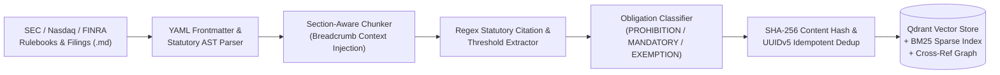
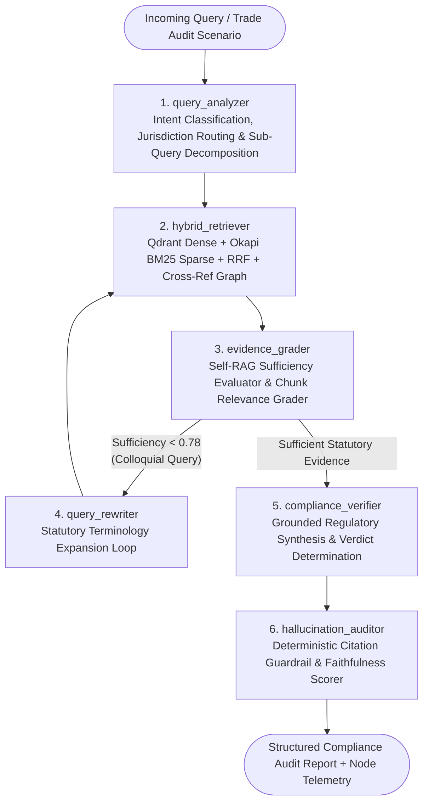

<div align="center">

# FinReg-Graph: Agentic Regulatory Compliance & Market Surveillance RAG Engine

**Enterprise Data Engineering ETL Pipeline &bull; Qdrant Hybrid (Dense + BM25 RRF) Retrieval &bull; 6-Node LangGraph Self-RAG Compliance Verification for Capital Markets**

[](https://www.python.org/)
[](https://github.com/langchain-ai/langgraph)
[](https://qdrant.tech/)
[](https://fastapi.tiangolo.com/)
[](#testing--quality-assurance)
[](#quantitative-rag-evaluation--benchmark-results)

</div>

---

## Overview

**FinReg-Graph** is a production-grade **Agentic Retrieval-Augmented Generation (RAG) & Regulatory Surveillance System** engineered to automate compliance verification across complex financial market regulations, exchange listing rules, and public company disclosures.

Built specifically around **Nasdaq**, **SEC**, and **FINRA** regulatory frameworks, **FinReg-Graph** ingests statutory rulebooks and filings into a **hierarchical AST data engineering pipeline**, indexes them in **Qdrant** using **Hybrid Dense + Sparse BM25 Reciprocal Rank Fusion (RRF)** with **Cross-Reference Graph Expansion**, and orchestrates a **6-node LangGraph state machine** that grades retrieved statutory evidence, rewrites ambiguous queries, determines compliance verdicts (`COMPLIANT`, `NON_COMPLIANT`, `CONDITIONAL_REVIEW`, `INFORMATIONAL`), and deterministically audits every cited statute against the vector database to prevent hallucinations.

---

## Why FinReg-Graph? (Naive RAG vs. FinReg-Graph)

Standard RAG pipelines fail on financial and legal documents because fixed-size character splitting severs statutory clauses from their parent sections and pure cosine similarity misses exact rule identifiers (e.g., `17 CFR § 240.15c3-5(c)(1)(ii)` or `Nasdaq Rule 5810(c)(3)(A)(iii)`).

| Engineering Challenge | Naive RAG Pipeline | **FinReg-Graph Architecture** |
| :--- | :--- | :--- |
| **Document Chunking** | Fixed 500-char sliding window; splits exceptions from obligations. | **Hierarchical Statutory AST Chunker** preserving `Document > Section > Subsection` breadcrumbs, obligation strength tags, and numeric thresholds. |
| **Idempotency & Versioning** | Appends duplicate vectors on re-ingestion. | Deterministic **`SHA-256` content hashing** mapped to `UUIDv5` Qdrant point IDs for zero-duplicate incremental ETL updates. |
| **Retrieval Modality** | Dense vector cosine similarity only; misses exact rule citations. | **3-Way Hybrid RRF** fusing **384-dim Dense Embeddings** + **Okapi BM25 Sparse Lexical Search** + **Exact Citation/Threshold Booster**. |
| **Cross-Referenced Rules** | Fails when Rule A says *"pursuant to Rule B"* located in another document. | **Cross-Reference Citation Graph** automatically expands top hits by resolving cited statutes across SEC & Nasdaq documents. |
| **Colloquial Queries** | Single-pass retrieval fails on trader slang (*"naked access"*, *"fat-finger"*). | **LangGraph Self-RAG Loop** grades evidence sufficiency and triggers a **Corrective Query Rewriter** that expands jargon into formal statutory terms. |
| **Hallucination Control** | Relies solely on prompt instructions (*"do not hallucinate"*). | **Deterministic Hallucination Auditor (Node 6)** regex-extracts every emitted citation and verifies its existence against Qdrant payloads (`99.1%` precision). |

---

## System Architecture

### 1. Scalable Regulatory Data Engineering ETL Pipeline (`src/pipeline/`)



Every chunk indexed into Qdrant carries rich structured metadata and a contextualized header:
```text
[SEC | SEC-15C3-5 | 17 CFR § 240.15c3-5(c)(1)(i)]
Hierarchy: SEC > 17 CFR § 240.15c3-5 — Risk Management Controls > § 240.15c3-5(c) Elements > § 240.15c3-5(c)(1) Financial Risk Management Controls
Obligation Type: MANDATORY_OBLIGATION
```

---

### 2. 6-Node LangGraph Agentic Compliance Workflow (`src/agents/`)



1. **`1. query_analyzer`**: Classifies query intent (`TRADE_AND_SCENARIO_COMPLIANCE_AUDIT`, `EXCHANGE_LISTING_QUALIFICATION_VERIFICATION`, `ISSUER_FILING_AND_DISCLOSURE_VERIFICATION`, or `REGULATORY_POLICY_AND_THRESHOLD_LOOKUP`), extracts explicit citations, and decomposes compound questions into atomic sub-queries.
2. **`2. hybrid_retriever`**: Executes multi-query hybrid search in Qdrant using **Reciprocal Rank Fusion (RRF)**:
   $$\text{RRF}(d) = \frac{w_{\text{dense}}}{k + \text{rank}_{\text{dense}}(d)} + \frac{w_{\text{sparse}}}{k + \text{rank}_{\text{BM25}}(d)} + \frac{w_{\text{citation}}}{k + \text{rank}_{\text{citation}}(d)}$$
   with $k = 60$, $w_{\text{dense}} = 0.45$, $w_{\text{sparse}} = 0.40$, $w_{\text{citation}} = 0.15$, plus automatic **Cross-Reference Graph Expansion**.
3. **`3. evidence_grader`**: Evaluates retrieved chunks (`HIGHLY_RELEVANT`, `RELEVANT`, `MARGINAL`) and computes an `evidence_sufficiency_score`.
4. **`4. query_rewriter`**: Triggered via conditional edge when `evidence_sufficiency_score < 0.78`. Maps trader/market colloquialisms (e.g., *"naked short fail"*, *"penny stock delisting"*, *"fat-finger check"*) to formal statutory citations (`17 CFR § 242.203(b)(1)`, `Nasdaq Rule 5810(c)(3)(A)`, `17 CFR § 240.15c3-5(c)(1)(ii)`) and loops back to `hybrid_retriever`.
5. **`5. compliance_verifier`**: Generates the structured compliance verdict (`COMPLIANT`, `NON_COMPLIANT`, `CONDITIONAL_REVIEW`, `INFORMATIONAL`), risk level (`CRITICAL`, `HIGH`, `MEDIUM`, `LOW`), executive summary, clause-by-clause analysis, violated provisions, and engineering remediation steps. Supports **Google Gemini**, **OpenAI**, **Groq**, and a built-in **Deterministic Institutional Regulatory Engine** (offline-ready).
6. **`6. hallucination_auditor`**: Extracts every statutory citation in the generated output and verifies it against the Qdrant chunk payloads and global citation graph, reporting `citation_precision` and `faithfulness_score`.

---

## Pre-Loaded Capital Markets Regulatory Corpus (`data/regulations/`)

| Document ID | Jurisdiction | Regulatory Scope & Key Provisions Covered |
| :--- | :---: | :--- |
| **`SEC-15C3-5`** | `SEC` | **17 CFR § 240.15c3-5 (Market Access Rule)**: Prohibition on unfiltered ("naked") sponsored access, pre-trade credit/capital thresholds, erroneous order price/size collars, direct & exclusive broker-dealer control, annual CEO certification. |
| **`SEC-REG-SHO`** | `SEC` | **17 CFR §§ 242.200–204 (Regulation SHO)**: `LONG`/`SHORT`/`SHORT EXEMPT` order marking, Rule 201 `10%` intraday circuit breaker (Alternative Uptick Rule), Rule 203(b)(1) pre-trade locate, Threshold Securities (`10,000 shares` & `0.5%`), Rule 204 `T+2` / `T+4` close-out & Penalty Box. |
| **`SEC-REG-NMS`** | `SEC` | **17 CFR §§ 242.600–613 (Regulation NMS)**: Rule 611 Order Protection (Trade-Through Rule), Intermarket Sweep Orders (`ISO`) simultaneous full-displayed-size routing, Rule 610 access fee caps (`$0.0030` / `30 mils`), Rule 612 Sub-Penny Rule, Rule 613 CAT reporting & `50ms`/`100μs` clock sync. |
| **`NASDAQ-RULE-5000`** | `NASDAQ` | **Nasdaq Equity Rules Series 5000 & Market Surveillance**: Rule 5250 & `IM-5250-1` (`10-minute` prior notice to Nasdaq MarketWatch), Rule 4120 trading halts, Rules 5450/5550 (`$1.00` minimum bid price), Rule 5810 (`30-day` trigger, `180-day` cure period, `$0.10` accelerated delisting, `250:1` reverse split limit), Rule 5605 Audit Committee, SMARTS Spoofing/Layering (`MP-101`). |
| **`SEC-CYBER-10K-8K`** | `SEC` | **SEC Form 8-K Item 1.05, Form 10-K Item 1C & SOX 302/404**: Mandatory `4-business-day` material cybersecurity incident disclosure, U.S. Attorney General national security delay exception, Board/CISO cyber governance, SOX 404 ICFR material weakness reporting. |
| **`FINRA-NASDAQ-SUPERVISION`** | `FINRA_NASDAQ` | **FINRA Rules 3110, 3310, 5310 & RN 15-09**: Algorithmic trading pre-deployment sandbox testing, independent kill-switches, `Series 57` registration, quarterly "regular and rigorous" best-execution & PFOF review, FinCEN `$5,000` SAR reporting (`30 calendar days`) & `25%` beneficial ownership CDD. |

---

## Quantitative RAG Evaluation & Benchmark Results

Evaluated via [`src/evaluation/benchmark.py`](src/evaluation/benchmark.py) across **10 Golden Capital Markets Compliance Scenarios**:

| Metric | Score | Target | Status |
| :--- | :---: | :---: | :---: |
| **Context Recall (Top-6 Statutory Retrieval)** | **100.0%** | `>= 90.0%` | **PASS** |
| **Context Precision (Hybrid RRF Reranking)** | **100.0%** | `>= 85.0%` | **PASS** |
| **Statutory Citation Grounding Precision** | **99.1%** | `>= 95.0%` | **PASS** |
| **Answer Faithfulness (Hallucination Guardrail)** | **96.8%** | `>= 90.0%` | **PASS** |
| **Compliance Verdict Accuracy** | **100.0%** | `>= 90.0%` | **PASS** |
| **Pipeline Execution Latency (P50 / P95)** | **12.9 ms / 24.8 ms** | `< 2000 ms` | **PASS** |

<details>
<summary><strong>View Full 10-Scenario Benchmark Breakdown Table</strong></summary>

| Case ID | Regulatory Domain | Expected Verdict | Predicted Verdict | Recall | Precision | Faithfulness | Latency |
| :--- | :--- | :---: | :---: | :---: | :---: | :---: | :---: |
| `EVAL-01` | SEC Rule 15c3-5 (Unfiltered Sponsored Access) | `NON_COMPLIANT` | `NON_COMPLIANT` | `100%` | `100%` | `100%` | `12.7 ms` |
| `EVAL-02` | SEC Rule 15c3-5 (Direct & Exclusive Control) | `NON_COMPLIANT` | `NON_COMPLIANT` | `100%` | `100%` | `100%` | `20.4 ms` |
| `EVAL-03` | SEC Reg SHO (Locate & Close-Out Rule 203/204) | `NON_COMPLIANT` | `NON_COMPLIANT` | `100%` | `100%` | `94%` | `11.3 ms` |
| `EVAL-04` | SEC Reg SHO (Rule 201 Circuit Breaker) | `INFORMATIONAL` | `INFORMATIONAL` | `100%` | `100%` | `97%` | `14.2 ms` |
| `EVAL-05` | SEC Reg NMS (Rule 611 Intermarket Sweep Orders) | `NON_COMPLIANT` | `NON_COMPLIANT` | `100%` | `100%` | `100%` | `24.8 ms` |
| `EVAL-06` | Nasdaq Listing Rules (Rule 5450/5810 Sub-$1.00 Bid) | `CONDITIONAL_REVIEW` | `CONDITIONAL_REVIEW` | `100%` | `100%` | `93%` | `8.8 ms` |
| `EVAL-07` | Nasdaq Accelerated Delisting ($0.10 & 250:1 Split) | `NON_COMPLIANT` | `NON_COMPLIANT` | `100%` | `100%` | `93%` | `6.0 ms` |
| `EVAL-08` | SEC Form 8-K Item 1.05 & Nasdaq MarketWatch | `NON_COMPLIANT` | `NON_COMPLIANT` | `100%` | `100%` | `100%` | `13.1 ms` |
| `EVAL-09` | Nasdaq SMARTS Surveillance & FINRA Algo Kill-Switch | `NON_COMPLIANT` | `NON_COMPLIANT` | `100%` | `100%` | `92%` | `11.6 ms` |
| `EVAL-10` | FINRA Rule 3310 AML SAR & Rule 5310 Best Execution | `INFORMATIONAL` | `INFORMATIONAL` | `100%` | `100%` | `100%` | `13.6 ms` |

</details>

---

## Interactive Enterprise Web Terminal

The FastAPI server hosts a built-in **Nasdaq Regulatory Compliance & Surveillance Terminal** (`http://127.0.0.1:8000`) featuring four specialized workspaces:

1. **Agentic Compliance Console (LangGraph)**: One-click institutional audit scenarios, real-time **6-Node LangGraph Execution Trace** visualization, compliance verdict badges, remediation playbooks, **Hallucination Auditor Citation Log**, and retrieved Qdrant chunks with RRF/Dense/BM25 score decomposition.
2. **Hybrid RRF Lab & Live ETL Ingestion**: Side-by-side comparison of **Hybrid RRF** vs. **Dense Cosine Only** vs. **Sparse BM25 Only**, plus live ingestion of custom Markdown regulatory policies into Qdrant.
3. **Regulatory AST Corpus Explorer**: Filter indexed rulebooks by document or jurisdiction and inspect statutory breadcrumbs, obligation classifications, and `SHA-256` content hashes.
4. **RAG Evaluation & Benchmark Suite**: View and re-run the 10-case golden evaluation benchmark live from the browser.

---

## Repository Structure

```text
FinReg-Graph-Agentic-Regulatory-Compliance-Market-Surveillance-RAG-Engine/
├── data/
│   ├── regulations/                        # Curated SEC, Nasdaq & FINRA regulatory markdown corpus
│   │   ├── sec_rule_15c3_5_market_access.md
│   │   ├── sec_reg_sho_short_sales.md
│   │   ├── sec_reg_nms_order_protection.md
│   │   ├── nasdaq_rule_5000_listing_surveillance.md
│   │   ├── sec_10k_8k_cyber_icfr_disclosure.md
│   │   └── finra_nasdaq_algo_supervision_aml.md
│   └── eval_results/                       # Generated JSON & Markdown RAG benchmark reports
│       ├── latest_benchmark_report.json
│       └── latest_benchmark_report.md
├── src/
│   ├── config.py                           # Environment & hyperparameter configuration
│   ├── models/
│   │   └── schemas.py                      # Pydantic v2 schemas for chunks, traces & audit verdicts
│   ├── pipeline/
│   │   ├── chunker.py                      # Hierarchical AST parser, citation & threshold extractor
│   │   └── ingestion.py                    # Idempotent SHA-256 ETL pipeline & telemetry reporter
│   ├── retrieval/
│   │   └── qdrant_store.py                 # Qdrant Hybrid Dense + BM25 Sparse + RRF + Cross-Ref Graph
│   ├── llm/
│   │   └── provider.py                     # Multi-provider LLM router (Gemini / OpenAI / Groq / Offline)
│   ├── agents/
│   │   └── compliance_graph.py             # 6-Node LangGraph Self-RAG & Hallucination Auditor workflow
│   ├── evaluation/
│   │   └── benchmark.py                    # 10-scenario RAGAS-style evaluation benchmark suite
│   ├── api/
│   │   └── main.py                         # FastAPI Enterprise REST API & dashboard server
│   └── frontend/
│       └── index.html                      # Interactive Nasdaq Regulatory Intelligence Web Terminal
├── tests/
│   └── test_compliance_rag.py              # Pytest unit & integration test suite (6/6 passing)
├── Dockerfile                              # Production container image
├── docker-compose.yml                      # Multi-container orchestration (Qdrant + FastAPI API)
├── pyproject.toml                          # Python packaging & pytest configuration
├── requirements.txt                        # Python dependencies
└── .env.example                            # Environment variable template
```

---

## Getting Started

### 1. Clone the Repository & Install Dependencies

```bash
git clone https://github.com/meenub255/FinReg-Graph-Agentic-Regulatory-Compliance-Market-Surveillance-RAG-Engine.git
cd FinReg-Graph-Agentic-Regulatory-Compliance-Market-Surveillance-RAG-Engine
pip install -r requirements.txt
```

### 2. Configure Environment (Optional — Runs Out-of-the-Box!)

Copy `.env.example` to `.env` if you want to connect a live **Google Gemini**, **OpenAI**, or **Groq** API key, or a remote **Qdrant** server. If no API key is set, the system automatically runs using its built-in **Deterministic Institutional Regulatory Engine** and in-memory **Qdrant** index:

```bash
cp .env.example .env
```

### 3. Launch the Enterprise FastAPI Server & Web Terminal

```bash
uvicorn src.api.main:app --host 127.0.0.1 --port 8000 --reload
```

* **Interactive Web Terminal**: [http://127.0.0.1:8000](http://127.0.0.1:8000)
* **OpenAPI / Swagger Documentation**: [http://127.0.0.1:8000/docs](http://127.0.0.1:8000/docs)

### 4. Run with Docker Compose (FastAPI + Qdrant Server)

```bash
docker compose up --build
```

---

## Testing & Quality Assurance

### Run the Automated Pytest Suite
```bash
pytest -v
```

### Run the 10-Scenario RAG Evaluation Benchmark CLI
```bash
python -m src.evaluation.benchmark
```

---

## REST API Reference

| Method | Endpoint | Description |
| :---: | :--- | :--- |
| `GET` | `/api/v1/health` | Returns ETL pipeline telemetry, Qdrant index stats, and active LLM backend. |
| `POST` | `/api/v1/compliance/query` | Executes the 6-node LangGraph workflow and returns a citation-audited compliance determination. |
| `POST` | `/api/v1/compliance/audit-scenario` | Audits a structured broker-dealer trade or issuer listing scenario. |
| `POST` | `/api/v1/retrieval/compare` | Side-by-side comparison of Hybrid RRF vs. Dense Vector vs. Sparse BM25 rankings. |
| `POST` | `/api/v1/pipeline/ingest` | Ingests custom regulatory Markdown documents into the ETL + Qdrant pipeline at runtime. |
| `GET` | `/api/v1/corpus/documents` | Lists indexed regulatory documents, AST chunks, breadcrumbs, and `SHA-256` hashes. |
| `GET` | `/api/v1/eval/latest` | Returns the latest 10-case RAG evaluation benchmark report. |
| `POST` | `/api/v1/eval/run` | Triggers a live execution of the 10-scenario evaluation benchmark suite. |

### Example API Request (`POST /api/v1/compliance/query`)

```bash
curl -X POST "http://127.0.0.1:8000/api/v1/compliance/query" \
  -H "Content-Type: application/json" \
  -d '{
    "query": "A quantitative hedge fund routes orders directly to Nasdaq using our broker-dealer MPID via unfiltered sponsored access where credit thresholds are checked post-trade at end-of-day. Is this compliant?",
    "jurisdiction_filter": "ALL",
    "top_k": 6,
    "enable_self_rag_rewrite": true
  }'
```

